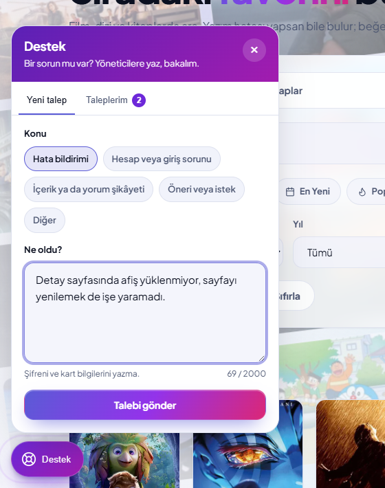

# Sosyal Kütüphane

İzlediğim filmleri, dizileri ve okuduğum kitapları takip edebildiğim, puan verip yorum yazabildiğim bir sosyal kütüphane. PHP + MongoDB ile yaptım, arayüz düz HTML/CSS/JS.

**Canlı demo:** https://sosyal-kutuphane-qr9i.onrender.com


## Ekran görüntüleri




## Neler var

- Film, dizi ve kitap arama (TMDB, Google Books), yazım hatası olsa da bulur
- İzledim / izlenecek listeleri, 1-10 puan, özel listeler
- Yorum, yanıt, beğeni ve tepki; spoiler gizleme; küfür ve hakaret filtresi
- "Ne izlesem?" önerisi (hesap gerektirir; süzgece uyan yapımların en popüler 1.000'i arasından seçer, kütüphanendekileri eler), Türkiye vizyon takvimi, yayın platformuna göre filtre
- Takip, akış, zevk eşleşmesi, ortak okuma/izleme, yıllık özet, rozetler
- Mesajlaşma, tarayıcı bildirimleri, IMDb/Letterboxd/Goodreads içe aktarma
- Sol alttaki destek düğmesiyle talep oluşturma ve yöneticiyle yazışma: yönetici yanıtlar, "çözüldü / çözülmedi" işaretler, kullanıcıya bildirim gider; yeni talep ve kullanıcı yanıtı yöneticilere bildirim (ve e-posta yapılandırılmışsa e-posta) olarak ulaşır
- Giriş yapamayan ziyaretçiler de aynı düğmeden talep açabilir (doğrulama kodu gelmediğinde gibi); spam koruması: gizli tuzak alan, en az doldurma süresi, e-posta başına günlük sınır
- Hesabı kalıcı silme (`profile.html` > Hesabı Sil): şifre (ve varsa 2 adımlı doğrulama kodu) istenir, kullanıcının bütün verisi silinir; KVKK aydınlatması `gizlilik.html` sayfasında
- Profil fotoğrafı yüklenirken yapay zekâ ile cinsel içerik, şiddet ve terör taraması
- Yönetim konsolu (`admin.html`) ve açık/koyu tema

## Demo hesaplar

Giriş ekranındaki butonlarla ya da `ahmet@test.com`, `ayse@test.com`, `test@test.com` ile girilir, şifre `123456`. Demo hesaplarda kütüphane her girişte sıfırlanır; yorum, puan ve mesaj gibi başkalarını etkileyen işlemler kapalıdır.

## Kurulum

1. MongoDB'yi çalıştır ve `composer install` yap.
2. `.env.example` dosyasını `.env` olarak kopyala, `MONGO_URI` ile `TMDB_API_KEY` değerlerini doldur.
3. `php api/setup-db.php` komutunu bir kez çalıştır (indeksleri ve demo hesapları kurar).
4. `START.bat` (Windows) ya da `START.sh` ile başlat, `http://localhost:8000/index.html` adresini aç.

Docker ile: `docker compose up`

| Değişken | Zorunlu | Ne için |
|---|---|---|
| `MONGO_URI`, `MONGO_DB` | Evet | Veritabanı |
| `TMDB_API_KEY` | Evet | Film ve dizi verisi |
| `GOOGLE_BOOKS_API_KEY` | Hayır | Kitap verisi |
| `BREVO_API_KEY` | Önerilir | E-postaları Brevo HTTPS API'si ile gönderir (Render gibi ortamlarda SMTP portu engellenebiliyor) |
| `SMTP_HOST`, `SMTP_PORT`, `SMTP_USERNAME`, `SMTP_PASSWORD`, `SMTP_FROM_EMAIL` | Evet | Kayıt doğrulama kodu ve şifre sıfırlama e-postası. Brevo önerilir (`smtp-relay.brevo.com`, 587) |
| `LLM_MODERATION_PROVIDER`, `LLM_MODERATION_API_KEY` | Hayır | Yorumlarda yapay zekâ ile ek küfür taraması (`gemini` veya `deepseek`); `gemini` ise profil fotoğrafları da cinsel içerik, şiddet ve terör için taranır |
| `VAPID_PUBLIC_KEY`, `VAPID_PRIVATE_KEY` | Hayır | Tarayıcı bildirimleri (`php scripts/make-vapid.php` ile üretilir) |

Anahtarlar sadece `.env` ya da ortam değişkenlerinde durur, depoya girmez.

Yüklenen profil fotoğrafları MongoDB'de de saklanır: Render gibi barındırıcılarda uygulamanın diski her dağıtımda silinir, fotoğraflar diskte yoksa veritabanından sunulur. Yapay zekâ taraması açıkken fotoğraf Google'a (Gemini) gönderilir, sunucuda tarama için ayrıca saklanmaz; hareketli GIF/WebP kabul edilmez ve kontrol edilemezse yükleme reddedilir.

Yöneticiler `ADMIN_EMAILS` ortam değişkeniyle (virgülle ayrılmış e-postalar) belirlenir; boşsa `api/lib/admins.php`'deki varsayılan e-posta kullanılır. `php api/setup-db.php` her açılışta (Render'da her dağıtımda) yöneticileri bu listeye eşitler: listedeki hesap yönetici olur, diğerlerinden yetki alınır. Listedeki e-postayla kayıtlı kimse yoksa hiçbir şeye dokunulmaz, yani yönetici sayısı sıfıra düşmez. `php scripts/make-admin.php` ile verilen yetki, e-posta listede değilse bir sonraki açılışta geri alınır.

## Canlıya alma

Render'da Blueprint olarak bu depoyu bağla (`render.yaml` hazır), `MONGO_URI`, `TMDB_API_KEY` ve `SITE_URL` değerlerini panelden gir. Atlas'ta Network Access'e `0.0.0.0/0` eklemek gerekir. Ücretsiz planda site 15 dakika istek gelmezse uyur ve ilk açılış yaklaşık yarım dakika sürer.

### Kapasite

Render ücretsiz plan (0,1 CPU, 512 MB) üzerinde, canlı siteye yalnızca okuma yapan kısa bir yük denemesi yapıldı (her sanal kullanıcı bir önbelleksiz ilk ziyaretin bütün isteklerini atar; 10 saniyede):

| Aynı anda gelen kullanıcı | İstek | Ortanca | p95 | Hata |
|---|---|---|---|---|
| 10 | 170 | 0,4 sn | 1,8 sn | 0 |
| 25 | 425 | 0,5 sn | 3,6 sn | 0 |
| 40 | 680 | 0,6 sn | 6,7 sn | 0 |

Ölçüm giriş yapmamış ziyaretçilerle yapıldı (canlıda veri yazmamak için). Giriş yapmış kullanıcı sayfa açıkken 20 saniyede bir bildirim sorgular (yaklaşık 3 veritabanı işlemi): 40 kişi için saniyede ~6 işlem, Atlas sınırının çok altında. Yani 30-40 kişinin aynı anda açması siteyi düşürmez, yalnızca ilk yükleme birkaç saniye uzar. Dikkat edilecekler:

- **Uyku:** Uyuyan siteyi ilk ziyaretçi bekleyerek uyandırır. `.github/workflows/keep-alive.yml` 5 dakikada bir ping atacak şekilde yazılı, ancak GitHub zamanlanmış işleri yoğun saatlerde saatlerce geciktirebilir; kesin çözüm için ücretsiz bir dış izleyici (UptimeRobot, cron-job.org) ile `/index.html` adresini 5 dakikada bir çağırmak ya da Render'ın ücretli planına geçmektir.
- **Veritabanı:** Atlas ücretsiz katmanı saniyede yaklaşık 100 işlem ve 500 bağlantıya izin verir; dolunca istekler kısa süre yavaşlar.
- **Canlı akış (SSE):** Her açık akış bir PHP sürecini tutar; bu yüzden varsayılan olarak kapalıdır (`ENABLE_SSE=0`).
- **Fazlası için:** Render'ın ücretli planı, Cloudflare (ücretsiz, statik dosyaları önbelleğe alır) ve Atlas'ın ücretli katmanı sırayla en çok işe yarayan adımlardır.

### Alan adı alırsan

1. Alan adını Render'da özel alan adı olarak ekle ve `SITE_URL` değişkenini güncelle.
2. Brevo'da alan adını doğrula (SPF, DKIM, DMARC), `SMTP_FROM_EMAIL`'i o alan adından bir adres yap.
3. Cloudflare üzerinden yönlendirmek önbellek ve DDoS koruması sağlar.
4. `gizlilik.html` (KVKK aydınlatması) şu an iletişim için destek formunu gösterir; ticari bir işletmeye dönüşürsen veri sorumlusu bilgisini ve bir iletişim adresini ekle.

Kayıt e-postaları kendi alan adın olmadan spama düşebilir. Brevo'da alan adını doğrulayıp (SPF/DKIM/DMARC kayıtları) `SMTP_FROM_EMAIL`'i o alan adından bir adres yaparsan gelen kutusuna düşme oranı belirgin artar; o zamana kadar kayıt ekranı kullanıcıyı Spam klasörüne bakmaya yönlendirir.

## Testler

```bash
# LLM_MODERATION_PROVIDER=none: .env'deki yapay zekâ anahtarı testlerde gerçek ağ isteği yapmasın
export MONGO_DB=social_library_test LLM_MODERATION_PROVIDER=none LLM_MODERATION_API_KEY=none
php -S 127.0.0.1:8001 -t . router.php &
php api/setup-db.php
TEST_BASE_URL=http://127.0.0.1:8001 TEST_MONGO_DB=social_library_test vendor/bin/phpunit

npm ci
npx playwright install chromium
npx playwright test
```

Testler `tests/` (PHPUnit) ve `tests/e2e/` (Playwright + erişilebilirlik) altında. Her push'ta GitHub Actions çalıştırır. Windows'ta `php -S` tek süreçlidir; `ENABLE_SSE` açık bırakılmamalı (canlı akış bağlantısı diğer istekleri bekletir).

## Klasörler

```
*.html, detail.php   sayfalar
api/                 PHP API uçları (api/lib: moderasyon, öneri, DM...)
js/, css/            istemci kodu ve stiller
partials/            ortak menü
tests/               PHPUnit ve Playwright testleri
scripts/             yönetici atama, menü ve alt bilgi eşitleme vb. yardımcılar
```
