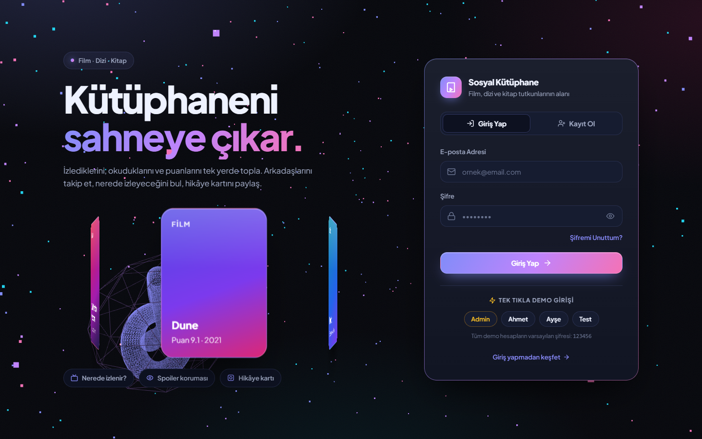
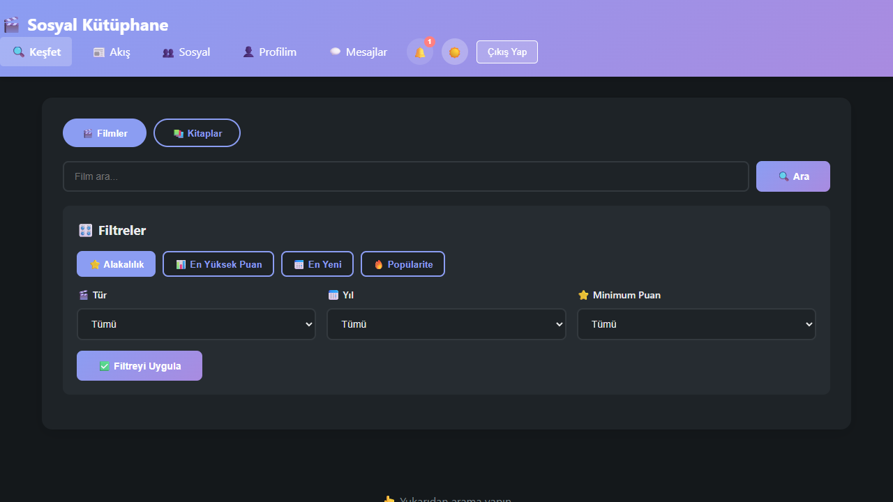
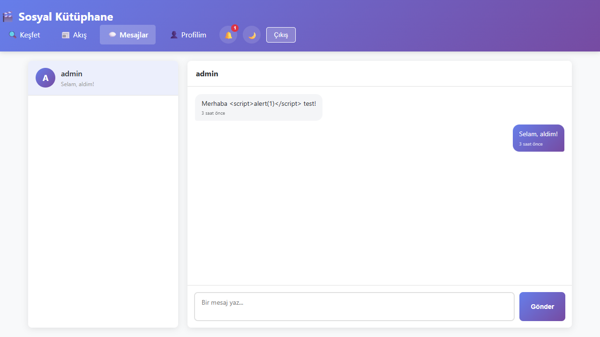

# Sosyal Kütüphane

Film, dizi ve kitaplar için yapılmış bir sosyal kütüphane ve paylaşım platformu. Kullanıcılar içerikleri arayıp izlediklerine/okuduklarına puan verebiliyor, yorum yazabiliyor, fragmanları izleyebiliyor, nerede yayınlandığını görüp Instagram hikaye kartları oluşturabiliyor. PHP ve MongoDB ile geliştirildi.




Karanlık mod ve arama:


Mesajlaşma:


## ✨ Öne Çıkan Özellikler

- 🔍 **Film, Dizi ve Kitap Keşfi**: TMDb ve Google Books entegrasyonu, tür ve yıl filtreleme
- 🧭 **Gelişmiş TMDb Keşif Motoru (Discover API)**: Yıl ve tür filtrelerinde tüm TMDb arşivi taranır (2025/2026 dahil on binlerce yapım ve sunucu taraflı sayfalama)
- 💡 **Akıllı Çapraz Arama**: Film sekmesindeyken dizi arandığında (ör. Güç Yüzükleri) otomatik dizi arşivi taranıp kullanıcıya doğrudan sonuç kartı ve kategori geçiş butonu sunulur
- 🍿 **Nerede İzlenir? (Türkiye)**: TMDb Watch Providers ile Netflix, Prime Video, BluTV, Apple TV yayın durumu (Abonelik / Kiralık / Satın Al)
- 🛡️ **Spoiler Koruması (Buzlu Cam)**: Sürprizbozan içeren yorumlar blurlu cam arkasında gizlenir, sadece tıklayanlar okuyabilir (göz simgeli şık kontrol)
- ⚡ **Canlı Arama Önerileri (Autocomplete)**: Arama kutusuna yazarken anında afişli ve puanlı canlı sonuç listesi (çapraz kategori destekli)
- 📈 **Gelişmiş Puan ve Yıl Filtreleri**: 2026 dahil dinamik yıl filtreleme ve TMDb güvenilir oy tabanlı (vote_count) en iyiler listelemesi
- ⌨️ **Caps Lock ve Durum Uyarıları**: Giriş ekranında Caps Lock algılama, zümrüt yeşili başarı ve kırmızı hata bildirimleri
- 📸 **Instagram Hikaye Kartı (Story Generator)**: HTML5 Canvas ile film/kitap afişi, puanı ve kullanıcı adıyla otomatik dikey (9:16) hikaye kartı üretip tek tıkla indirme veya paylaşma
- ⚡ **Tek Tıkla Demo Girişi**: Giriş sayfasında şifre yazmadan tek tıkla admin veya demo hesapla giriş yapabilme
- 👁️ **Sıfır Kaymalı Parola Göster/Gizle**: Modern SVG ikonlarla formu kaydırmayan akıcı şifre toggle kontrolü
- 🎨 **Sinematik Tasarım ve 3D Giriş**: Three.js ile parçacık alanı ve dönen tel kafes, CSS 3D poster halkası, fare ile eğilen cam kartlar, yüzen cam menü ve koyu/açık tema uyumu
- ⭐ **Kütüphane Yönetimi**: İzlediklerim, İzleyeceklerim, Okuduklarım, Okuyacaklarım ve 1-10 arası puanlama
- 💬 **Yorum ve Sosyal Etkileşim**: İçeriklere yorum yapma, yorum beğenme, yanıtlama
- 👥 **Takip ve Sosyal Akış**: Kullanıcıları takip etme, kişisel feed akışı
- 🔔 **Canlı Bildirimler**: Takip, yorum ve mesaj bildirimleri (navbar'da dinamik rozet)
- 💬 **Doğrudan Mesajlaşma (DM)**: Kullanıcılar arasında özel mesajlaşma
- 📁 **Özel Listeler**: İstediğin başlıkta koleksiyon listesi oluşturup paylaşma
- ⚙️ **Hesap Yönetimi**: Profil fotoğrafı (avatar) yükleme, şifre ve 2FA (Authenticator) ayarları
- 🌙 **Karanlık / Açık Tema**: Göz yormayan koyu mod desteği (formlar ve textarea dahil tam uyumlu)
- 🏅 **Rozetler**: İlk adım, sinefil, kitap kurdu, eleştirmen ve daha fazlası; profilde ilerleme çubuklarıyla
- 🗓️ **Yeni Çıkanlar ve Hatırlatıcı**: Yakında vizyona girecek filmler (TMDB, Türkiye). Vizyon tarihi gelince bildirim alırsın
- ⚡ **Canlı Bildirim ve Yazıyor Göstergesi**: Server-Sent Events ile anlık bildirim ve mesajlaşmada yazıyor bilgisi. Kapalıysa yoklamaya döner
- 📥 **Letterboxd ve Goodreads İçe Aktarma**: watched / ratings / watchlist ve Goodreads CSV dosyalarını kütüphanene aktar

## Kullanılan Teknolojiler

PHP 8+, MongoDB (`mongodb/mongodb` paketi), HTML/CSS/JS, PHPMailer (şifre sıfırlama ve doğrulama kodları için). MongoDB yerelde ya da Atlas'ta çalışabilir, `.env` içindeki `MONGO_URI` değerini ayarlamak yeterli.

Film/dizi verisi TMDB'den, kitap verisi Google Books'tan geliyor. Tarayıcı bu servislere doğrudan gitmiyor, istekler `api/tmdb-proxy.php` ve `api/books-proxy.php` üzerinden geçip `api_cache` koleksiyonunda saklanıyor (popüler listeler 6 saat, arama 1 saat, detay 24 saat). Böylece API anahtarları tarayıcıda gizli kalıyor ve aynı veri tekrar tekrar indirilmiyor.

## Çalıştırma

### Docker ile:

```bash
docker compose up
```

`http://localhost:8000/index.html` adresinde açılır, veritabanı ve demo hesaplar otomatik oluşturulur.

### Manuel Kurulum:

1. MongoDB'nin çalıştığından emin olun (varsayılan port 27017) ve `composer install` çalıştırın.
2. `.env.example` dosyasını `.env` olarak kopyalayın (`copy .env.example .env`). Yerel MongoDB için varsayılanlar yeterlidir.
3. `.env` içine `TMDB_API_KEY` yazın ([themoviedb.org](https://www.themoviedb.org/settings/api) üzerinden ücretsiz alınıyor), film ve dizi araması ile fragman/nerede izlenir özellikleri bu anahtarla çalışır. `GOOGLE_BOOKS_API_KEY` opsiyoneldir.
4. Şifre sıfırlama e-postası için `SMTP_USERNAME` ve `SMTP_PASSWORD` doldurulabilir. Boş bırakılırsa sıfırlama linki sunucu loguna yazılır.
5. Tarayıcıda `http://localhost:8000/api/setup-db.php` adresini bir kez açın, indeksleri ve demo hesapları oluşturur.
6. `START.bat` (Windows) ya da `START.sh` (Mac/Linux) ile sunucuyu başlatıp `http://localhost:8000/index.html` adresine girin.

### Demo Hesaplar:
Giriş sayfasındaki hazır demo butonlarına tıklayabilir veya manuel girebilirsiniz:
- **ahmet@test.com** (Kullanıcı)
- **ayse@test.com** (Kullanıcı)
- **test@test.com** (Kullanıcı)

*(Tüm demo hesapların şifresi: `123456`)*

### Yönetici Yetkisi:
Demo yönetici hesabı kaldırıldı; kurulum artık admin@test.com için varsayılan şifreyi devre dışı bırakır. Yönetici yetkisi yalnızca komut satırından verilir (yorum şikayetlerini inceleyen `admin.html` sayfası için):

```bash
php scripts/make-admin.php kullanici@ornek.com
```

Betik web üzerinden erişilemez; `MONGO_URI` ve `MONGO_DB` ayarlarıyla aynı veritabanına yazar.

## Render'da Yayınlama

Repodaki `Dockerfile` Render'da doğrudan çalışmaktadır:

1. [render.com](https://render.com)'da GitHub ile girip **New > Web Service** ile bu repoyu seçin, Runtime olarak **Docker** seçilir.
2. Environment sekmesine `.env` içindeki değerleri ekleyin: `MONGO_URI`, `MONGO_DB`, `TMDB_API_KEY`, `GOOGLE_BOOKS_API_KEY` (isteğe bağlı).
3. `SITE_URL` olarak Render'ın verdiği `https://<servis-adi>.onrender.com` adresini girin ve yeniden deploy edin (CORS bu değere bakar).
4. İlk açılışta `api/setup-db.php` indeksleri ve demo hesapları kendiliğinden oluşturur.

### Canlı bildirimler (SSE)

Bildirimler ve "yazıyor" göstergesi varsayılan olarak 20 saniyede bir yoklama ile çalışır. Canlı akış için iki ayar gerekir: `ENABLE_SSE=1` ve `PHP_CLI_SERVER_WORKERS` (Docker imajında 4). Her açık akış bir PHP sürecini tuttuğu için, süreç sayısından fazla kişi aynı anda bağlanırsa site yavaşlar. Bu yüzden canlı akış varsayılan olarak kapalıdır; yoğun kullanımda gerçek bir async sunucuya (ör. Node veya Go) geçilmesi önerilir. Windows'ta `START.bat` tek süreçli çalıştığı için akış orada kapalı kalır.

## Testler

Testler izole test veritabanına karşı koşar:

```bash
composer install
MONGO_DB=social_library_test php -S localhost:8001 &
TEST_BASE_URL=http://localhost:8001 vendor/bin/phpunit --testdox
node --test tests/escape-html.test.mjs
```

PowerShell'de `MONGO_DB` ve `TEST_BASE_URL` değişkenleri `$env:MONGO_DB='social_library_test'` biçiminde ayrı satırlarda verilir. Her push'ta GitHub Actions aynı testleri kendi MongoDB konteynerine karşı çalıştırır (`.github/workflows/ci.yml`).

### Tarayıcı ve Erişilebilirlik Testleri (Playwright + axe)

Testler `tests/e2e/` altındadır. Veritabanı gerektiren akışlar için önce PHP sunucusunun ve MongoDB'nin çalışıyor olması gerekir.

```bash
npm ci
npx playwright install chromium
npx playwright test
```

Yerelde kurulu Microsoft Edge ile çalıştırmak için `PW_CHANNEL=msedge npx playwright test` kullanabilirsin. Sunucu zaten ayaktaysa `E2E_BASE_URL=http://localhost:8000` ile yeniden kullanılır.

## Klasör Yapısı

```
index.html     Giriş ve kayıt sayfası (3D sahne, poster halkası)
search.html    Arama ve keşfet sayfası
profile.html   Profil ve hesap ayarları
messages.html  Doğrudan mesajlaşma
detail.php     İçerik detayı, fragman oynatıcı ve hikaye kartı
api/           PHP backend API uçları
js/            JavaScript yardımcıları, istemci mantığı ve 3D giriş sahnesi (scene.js)
css/           Stil dosyaları (tasarım token'ları, cam efektleri, karanlık mod)
tests/         PHPUnit, Node ve Playwright (tests/e2e) testleri
scripts/       Yardımcı komutlar (make-admin.php: yönetici yetkisi verme)
START.bat      Geliştirme sunucusu başlatıcı (Windows)
START.sh       Geliştirme sunucusu başlatıcı (Mac/Linux)
```

## Sorun Giderme

- **"Sunucuya bağlanılamıyor"**: `START.bat` veya dev sunucusunun açık olduğunu kontrol edin.
- **"Veritabanı bağlantı hatası"**: MongoDB servisinin açık olduğunu ve `.env` içindeki `MONGO_URI`'nin doğru olduğunu kontrol edin. Atlas kullanıyorsanız Network Access listesine mevcut IP adresinizi (veya geliştirme için `0.0.0.0/0`) ekleyin.
- **"Giriş yapılamıyor"**: Tarayıcıyı yenileyin (F5) veya demo butonlarını kullanın.
