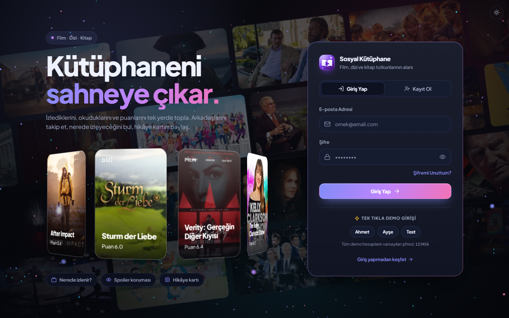
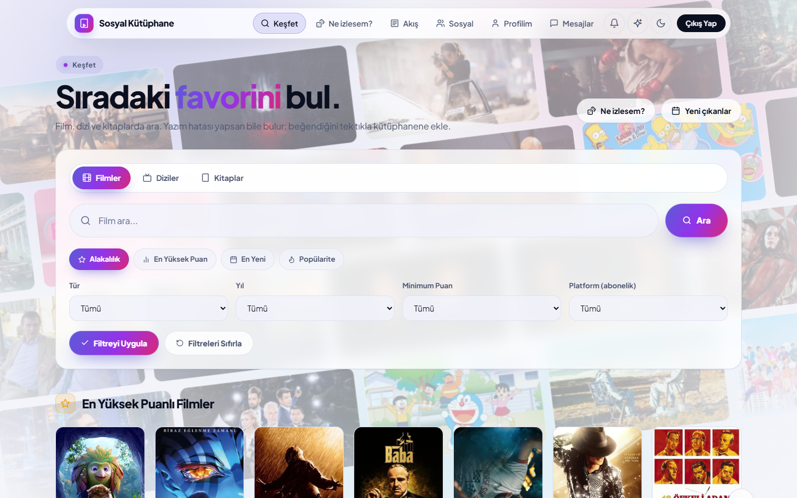
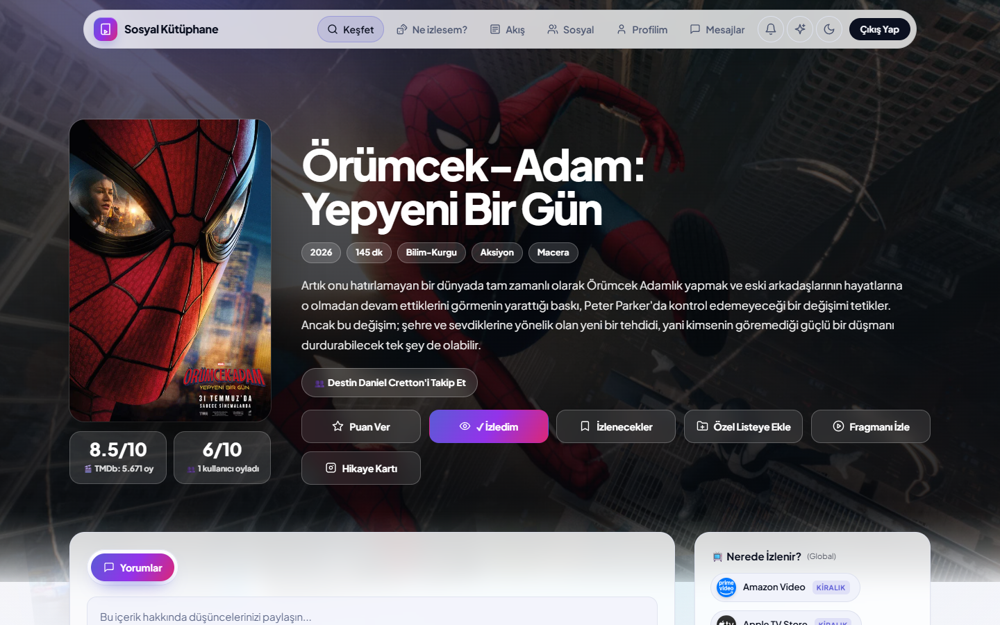
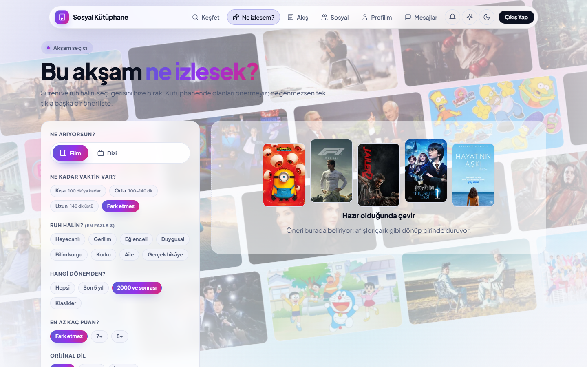
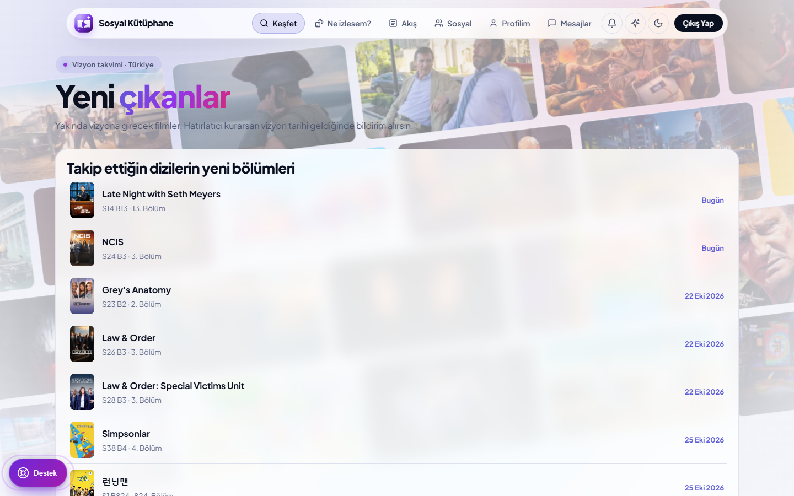
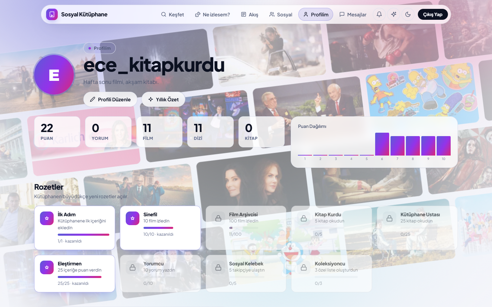
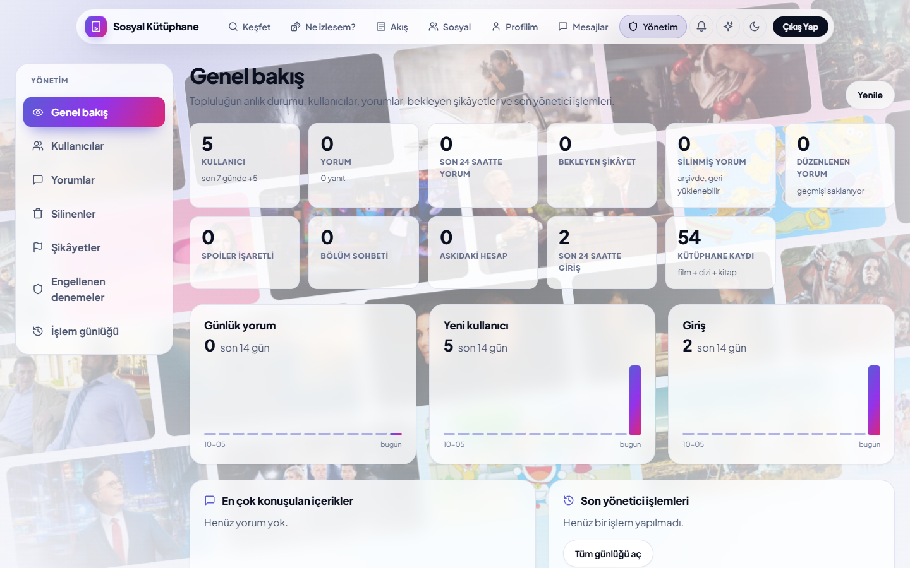

# Sosyal Kütüphane

İzlediğim filmleri, dizileri ve okuduğum kitapları takip edebildiğim, puan verip yorum yazabildiğim bir sosyal kütüphane. PHP + MongoDB ile yaptım, arayüz düz HTML/CSS/JS.

**Canlı demo:** https://sosyal-kutuphane-qr9i.onrender.com


## Ekran görüntüleri















## Neler var

- Film, dizi ve kitap arama (TMDB, Google Books), yazım hatası olsa da bulur
- İzledim / izlenecek listeleri, 1-10 puan, özel listeler
- Yorum, yanıt, beğeni ve tepki; spoiler gizleme; küfür ve hakaret filtresi
- "Ne izlesem?" önerisi, yeni çıkanlar takvimi, yayın platformuna göre filtre
- Takip, akış, zevk eşleşmesi, ortak okuma/izleme, yıllık özet, rozetler
- Mesajlaşma, tarayıcı bildirimleri, IMDb/Letterboxd/Goodreads içe aktarma
- Yönetim konsolu (`admin.html`) ve açık/koyu tema

## Demo hesaplar

Giriş ekranındaki butonlarla ya da `ahmet@test.com`, `ayse@test.com`, `test@test.com` ile girilir, şifre `123456`. Demo hesaplarda kütüphane her girişte sıfırlanır; yorum, puan ve mesaj gibi başkalarını etkileyen işlemler kapalıdır.

## Kurulum

1. MongoDB'yi çalıştır ve `composer install` yap.
2. `.env.example` dosyasını `.env` olarak kopyala, `MONGO_URI` ile `TMDB_API_KEY` değerlerini doldur.
3. `php api/setup-db.php` komutunu bir kez çalıştır (indeksleri ve demo hesapları kurar).
4. `START.bat` (Windows) ya da `START.sh` ile başlat, `http://localhost:8000/index.html` adresini aç.

Docker ile: `docker compose up`

| Değişken | Zorunlu | Ne için |
|---|---|---|
| `MONGO_URI`, `MONGO_DB` | Evet | Veritabanı |
| `TMDB_API_KEY` | Evet | Film ve dizi verisi |
| `GOOGLE_BOOKS_API_KEY` | Hayır | Kitap verisi |
| `BREVO_API_KEY` | Önerilir | E-postaları Brevo HTTPS API'si ile gönderir (Render gibi ortamlarda SMTP portu engellenebiliyor) |
| `SMTP_HOST`, `SMTP_PORT`, `SMTP_USERNAME`, `SMTP_PASSWORD`, `SMTP_FROM_EMAIL` | Evet | Kayıt doğrulama kodu ve şifre sıfırlama e-postası. Brevo önerilir (`smtp-relay.brevo.com`, 587) |
| `LLM_MODERATION_PROVIDER`, `LLM_MODERATION_API_KEY` | Hayır | Yorumlarda yapay zekâ ile ek küfür taraması (`gemini` veya `deepseek`) |
| `VAPID_PUBLIC_KEY`, `VAPID_PRIVATE_KEY` | Hayır | Tarayıcı bildirimleri (`php scripts/make-vapid.php` ile üretilir) |

Anahtarlar sadece `.env` ya da ortam değişkenlerinde durur, depoya girmez.

Yönetici yapmak için: `php scripts/make-admin.php kullanici@ornek.com`

## Canlıya alma

Render'da Blueprint olarak bu depoyu bağla (`render.yaml` hazır), `MONGO_URI`, `TMDB_API_KEY` ve `SITE_URL` değerlerini panelden gir. Atlas'ta Network Access'e `0.0.0.0/0` eklemek gerekir. Ücretsiz planda site bir süre kullanılmazsa uyur, ilk açılış yavaş olur.

## Testler

```bash
MONGO_DB=social_library_test php -S 127.0.0.1:8001 -t . router.php &
MONGO_DB=social_library_test php api/setup-db.php
TEST_BASE_URL=http://127.0.0.1:8001 TEST_MONGO_DB=social_library_test vendor/bin/phpunit

npm ci
npx playwright install chromium
npx playwright test
```

Testler `tests/` (PHPUnit) ve `tests/e2e/` (Playwright + erişilebilirlik) altında. Her push'ta GitHub Actions çalıştırır.

## Klasörler

```
*.html, detail.php   sayfalar
api/                 PHP API uçları (api/lib: moderasyon, öneri, DM...)
js/, css/            istemci kodu ve stiller
partials/            ortak menü
tests/               PHPUnit ve Playwright testleri
scripts/             yönetici atama, menü eşitleme vb. yardımcılar
```
